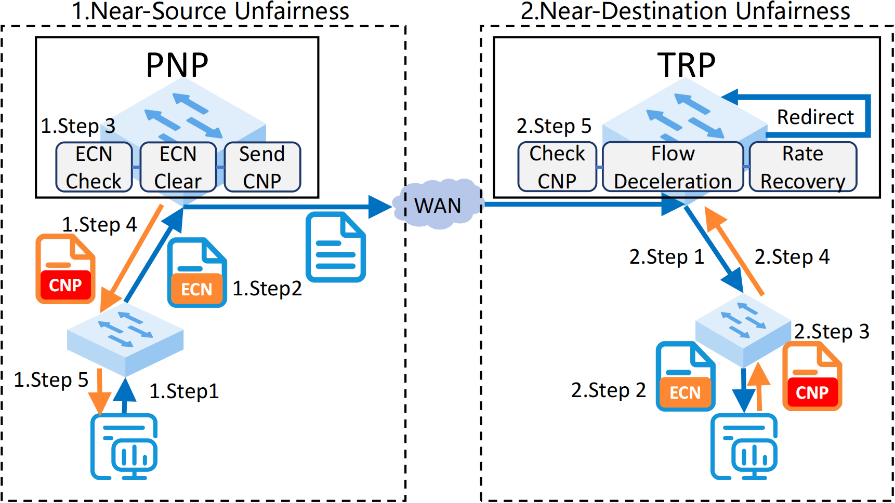

# THEMIS: Addressing Congestion-Induced Unfairness in Long-Haul RDMA Networks

<p align="center">
  <a href="#icnp-2025"></a>
  <a href="#ieeeacm-transactions-on-networking"></a>
</p>

THEMIS is a fairness-maintenance patch for long-haul RDMA networks. It addresses congestion-induced unfairness caused by asymmetric feedback delays between inter-datacenter and intra-datacenter flows. The implementation combines a **Proactive Notification Point (PNP)** for near-source congestion with a **Temporary Reaction Point (TRP)** for near-destination congestion.



## Papers and Code

This repository contains the open-source artifacts for two versions of THEMIS. Use the branch corresponding to the paper you are reproducing:

| Paper | Code branch | Artifact |
| --- | --- | --- |
| ICNP 2025 conference paper | [`main`](https://github.com/Networked-System-and-Security-Group/Themis/tree/main) | NS-3 simulation and P4/eBPF/RDMA testbed |
| IEEE/ACM Transactions on Networking extended paper | [`TON`](https://github.com/Networked-System-and-Security-Group/Themis/tree/TON) | Extended-version source code |

## Repository Layout

| Path | Description |
| --- | --- |
| [`NS3/simulation/`](NS3/simulation/) | NS-3 simulation code and example configurations |
| [`NS3/traffic_gen/`](NS3/traffic_gen/) | Traffic and workload generation utilities |
| [`NS3/analysis/`](NS3/analysis/) | Simulation trace and performance analysis tools |
| [`P4/`](P4/) | P4 dataplane and switch control-plane code |
| [`eBPF/`](eBPF/) | eBPF-based daemon used by the testbed prototype |
| [`RDMA_RC_example/`](RDMA_RC_example/) | RDMA RC example used for host-to-host testing |

## Key Features

### Proactive Notification Point (PNP)

Reduces feedback delay for near-source bottlenecks by generating congestion notifications (CNPs) within a single DC.

### Temporary Reaction Point (TRP)

Temporarily throttles inter-DC flows to address near-destination bottlenecks until the sender receives congestion feedback.

### Compatibility

THEMIS is designed to be compatible with existing congestion control algorithms like DCQCN.

### Minimal Modifications

THEMIS requires only modifications at the external switches (ESW) connecting the DC to the WAN, ensuring minimal impact on existing infrastructure.

### Resource Efficiency

The implementation is optimized to minimize resource overhead on switches, making it deployable on current hardware.

## Getting Started

### NS-3 Simulation

The NS-3 module is developed based on the [HPCC](https://github.com/alibaba-edu/High-Precision-Congestion-Control) project. The project configuration method is consistent with HPCC. Start with the [simulation README](NS3/simulation/README.md), then see the [traffic generator](NS3/traffic_gen/README.md) and [analysis guide](NS3/analysis/README.md) for workload creation and result processing.

#### Quickstart

From the repository root, the original example workflow is:

```sh
cd NS3/simulation
./waf --run 'scratch/third mix/mix_70%_0.03s/config.txt' > mix/mix_70%_0.03s/out.txt
cd mix/mix_70%_0.03s
python3 annalyze.py
```

The figures used in the paper were generated through `NS3/analysis`.

### Hardware Testbed

The testbed prototype uses a P4-capable Barefoot/Tofino switch, the corresponding SDE, Linux hosts with RDMA-capable NICs, and the required RDMA and eBPF software. The switch pipeline and control-plane build targets are documented in [`P4/Makefile`](P4/Makefile); the RDMA example build and client/server invocation are in [`RDMA_RC_example/README.md`](RDMA_RC_example/README.md). The daemon entry point is [`eBPF/daemon.py`](eBPF/daemon.py).

The logical testbed topology is:

```text
Host A --- P4 switch --- Host B
```

The testbed verifies whether the daemon packet sent via eBPF can be received by the switch CPU in time and whether the flow rule can be installed before the first RDMA data packet arrives.

Hardware setup depends on the installed switch SDE, NIC, and host configuration. Configure those for your environment before running the prototype.

#### Quickstart

Start the switch:

```sh
cd P4
$SDE_INSTALL/bin/bf_kdrv_mod_load $SDE_INSTALL
ls /dev/bf0
make switch
./control
```

Start the eBPF daemon:

```sh
cd eBPF
sudo python daemon.py
```

Build and start the RDMA RC transfer. Run the server command on Host B and the client command on Host A:

```sh
cd RDMA_RC_example
gcc -Wall -O2 -o RDMA_RC_example RDMA_RC_example.c -libverbs

# Host B (server)
./RDMA_RC_example -g 3 -d mlx5_0

# Host A (client)
./RDMA_RC_example -g 3 -d mlx5_0 <IP of HOST B>
```

## Citation

### ICNP 2025

The `main` branch corresponds to the conference paper:

> Z. Niu, M. Zhang, J. Zhang, R. Xie, Y. Yang, and X. Hu, "THEMIS: Addressing Congestion-Induced Unfairness in Long-Haul RDMA Networks," in *2025 IEEE 33rd International Conference on Network Protocols (ICNP)*, Seoul, Republic of Korea, 2025, pp. 1–13, doi: [10.1109/ICNP65844.2025.11192376](https://doi.org/10.1109/ICNP65844.2025.11192376).

```bibtex
@inproceedings{niu2025themis,
  title={THEMIS: Addressing Congestion-Induced Unfairness in Long-Haul RDMA Networks},
  author={Niu, Zihan and Zhang, Menghao and Zhang, Jue and Xie, Renjie and Yang, Yuan and Hu, Xiaohe},
  booktitle={2025 IEEE 33rd International Conference on Network Protocols (ICNP)},
  pages={1--13},
  year={2025},
  organization={IEEE},
  doi={10.1109/ICNP65844.2025.11192376}
}
```

### IEEE/ACM Transactions on Networking

The `TON` branch corresponds to the extended journal paper:

> M. Zhang, Z. Niu, J. Zhang, D. Wang, R. Xie, Y. Yang, M. Xu, and C. Hu, "THEMIS: Addressing Congestion-Induced Unfairness in Long-Haul RDMA Networks," *IEEE/ACM Transactions on Networking*, 2026, doi: [10.1109/TON.2026.3743177](https://doi.org/10.1109/TON.2026.3743177).

```bibtex
@article{zhang2026themis,
  title={THEMIS: Addressing Congestion-Induced Unfairness in Long-Haul RDMA Networks},
  author={Zhang, Menghao and Niu, Zihan and Zhang, Jue and Wang, Dongyang and Xie, Renjie and Yang, Yuan and Xu, Mingwei and Hu, Chunming},
  journal={IEEE/ACM Transactions on Networking},
  year={2026},
  doi={10.1109/TON.2026.3743177}
}
```
